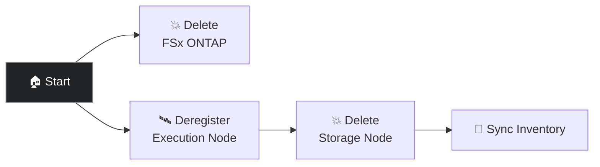

# Destroy a Storage Stack on AWS

Tears down what [Deploy a Storage Stack on AWS](./deploy-storage-stack.md) created: deletes the Amazon FSx for NetApp ONTAP file system and its inventory host, removes the execution node from AAP, terminates its VM, and re-syncs the AWS inventory.

> **Data loss:** deleting the file system deletes the data on it. The workflow does not ask for confirmation.

## Prerequisites

- A storage stack previously deployed with **Deploy a Storage Stack on AWS**
- **AWS** and **AAP Credential** configured (both come from setup)

## Survey prompts

| Prompt | Variable | Type | Required | Default |
|--------|----------|------|----------|---------|
| AWS Region | `create_vm_aws_region` | multiplechoice | Yes | `us-east-2` |

Select the region used for deploy. Everything else, including the VM, stack, and file system names, is read from the same shared names as the deploy workflow.

## Workflow

The two branches run **in parallel**. Each failure files a **SUBMIT FEEDBACK** ticket.

1. **Delete FSx ONTAP** looks up the CloudFormation stack `aws-ontap-stack` and **refuses to delete it unless it is tagged `managed-by=aap-product-demos`**, so a mistyped name cannot remove someone else's stack. It then deletes the stack, which deletes the file system, and removes the `aws-ontap` host from the storage inventory. If the stack does not exist, it reports that and carries on.
2. **Deregister Execution Node** detaches the instance group from the storage inventory, so no new storage jobs are scheduled onto a node that is going away. It then sets the node to deprovisioning and waits (up to 5 minutes) until AAP has removed the instance.
3. **Delete Storage Node** terminates the VM `aws-storage-node`. It only starts after the node is deregistered, so AAP can still reach the VM while it deprovisions the node.
4. **Sync Inventory** removes the VM from AAP's AWS inventory.

## What is not removed

| Left behind | What to do |
|-------------|------------|
| The keypair, VPC, subnet, and security group | Run [Destroy Cloud Stack in AWS](./cloud-destroy-stack.md) **after** this workflow. The VPC cannot be deleted while the file system and the VM still use it |
| The empty `storage` instance group and the empty storage inventory | Harmless; the next deploy reuses them |
| The VM's Red Hat Subscription Management registration | This workflow does not unregister the VM. Remove the system from your Red Hat subscription management account if you want it gone |

## Known limits

- If the VM is already gone but AAP still lists its instance, **Deregister Execution Node** cannot find the node and stops without changing anything. Remove the instance by hand under **Automation Execution → Infrastructure → Instances**.
- Re-running is safe: a missing stack, a missing VM, or a node that is not registered is reported and skipped.

## Job templates

| Job template | Playbook |
|--------------|----------|
| Cloud ǀ AWS ǀ Delete FSx ONTAP | [`cloud/delete_fsx_ontap.yml`](../delete_fsx_ontap.yml) |
| Cloud ǀ AWS ǀ Deregister Execution Node | [`cloud/deregister_execution_node.yml`](../deregister_execution_node.yml) |
| Cloud ǀ AWS ǀ Delete Stack VM | [`cloud/delete_vm_by_name.yml`](../delete_vm_by_name.yml) |

## Presenter walkthrough

1. **When to use:** at the end of a storage demo, or to start over. Remind the audience that it deletes the data on the file system.
2. **Launch:** select the same region used for deploy. That is the only prompt.
3. **Watch the order:** the file system is deleted in one branch while the node is deregistered in the other. Point out that the VM is only terminated once AAP has removed the node.
4. **Clean up the rest:** run **Destroy Cloud Stack in AWS** to remove the VPC and keypair.

## Related demos

| Demo | Description |
|------|-------------|
| 🚀 [Deploy a Storage Stack on AWS](./deploy-storage-stack.md) | The matching provisioning workflow |
| 💥 [Destroy Cloud Stack in AWS](./cloud-destroy-stack.md) | Removes the VPC and keypair afterwards |
