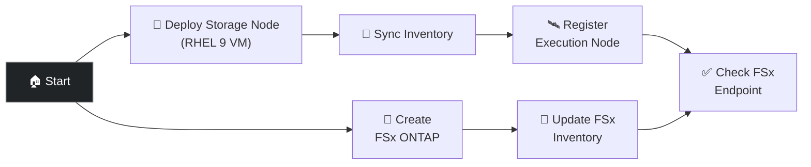

# Deploy a Storage Stack on AWS

Adds storage to the cloud demo environment: a RHEL 9 VM registered with AAP as an **execution node**, and an **Amazon FSx for NetApp ONTAP** file system in the same VPC. The file system goes into its own inventory, and jobs that use that inventory run on the new node. That matters because ONTAP's management endpoint is on a private subnet, which AAP's own control plane usually cannot reach. Use it to demo storage automation with the `netapp.ontap` collection.

> **Cost:** the VM and the file system keep running, and keep costing money, until you run [Destroy a Storage Stack on AWS](./cloud-destroy-storage-stack.md).

## Prerequisites

- **Run [Deploy Cloud Stack in AWS](./deploy-cloud-stack.md) first, in the same region.** This workflow reuses its keypair `aws-test-key`, subnet `aws-test-subnet`, and security group `aws-test-sg`. That security group allows TCP 27199, which the automation mesh uses.
- **AAP 2.7.** The 2.5 and 2.6 execution environments do not include the collections this demo needs (`ansible.receptor` and `netapp.ontap`).
- **Setup:** run **APD ǀ Single demo setup** and choose `cloud` (or **APD ǀ Multi-demo setup**). This creates the job templates, the `storage` label, the credentials below, and the **Ansible Product Demos Storage Inventory**.
- **Network:** AAP's control plane must be able to open a connection to the VM's public DNS name on TCP 27199.

### Credentials

| Credential | Used for | What to enter |
|------------|----------|---------------|
| **AWS** | All AWS jobs | Access Key and Secret Key |
| **APD Machine Credential** | Creating the VM and installing receptor on it | SSH private key (the same one Deploy Cloud Stack uses) |
| **RHSM Registration** | Giving the VM access to the AAP repository | Red Hat organization ID and an activation key that entitles RHEL and Ansible Automation Platform |
| **FSx ONTAP** | Setting the `fsxadmin` password and logging in to ONTAP | The `fsxadmin` password you want, which must meet FSx's password rules. Setup seeds it with `REPLACEME`, and the jobs stop with a clear message until you replace it |
| **AAP Credential** | Letting playbooks call the AAP API | Created by setup |

## Survey prompts

| Prompt | Variable | Type | Default | Description |
|--------|----------|------|---------|-------------|
| AWS Region | `create_vm_aws_region` | multiplechoice | `us-east-2` | Region for the VM and the file system. Must match the region of your cloud stack |
| Owner | `create_vm_aws_owner_tag` | text | `your_name` | `owner` tag on the VM and the file system |
| Environment | `vm_environment` | multiplechoice | `Prod` | `environment` tag on the VM and the file system (`Dev`, `QA`, or `Prod`). Metadata only |
| Email | `email` | text | `your_name@acme.org` | Operator contact; **not** applied as a tag and not used by the playbooks |

The answers are passed to every job in the workflow, so each job template's own region, owner, and environment prompts are optional when launched from here.

## Workflow

The VM branch and the file system branch run **in parallel**, because creating the file system takes a while (often 20 minutes or more). Each failure files a **SUBMIT FEEDBACK** ticket.

1. **Deploy Storage Node** creates the RHEL 9 VM `aws-storage-node` from the `rhel9` blueprint, with deployment tag `storage_stack`.
2. **Sync Inventory** imports the new VM into AAP.
3. **Register Execution Node** turns the VM into an AAP execution node:
   - creates the instance in AAP (type `execution`, listener port 27199) and downloads its install bundle;
   - registers the VM with Red Hat Subscription Management and enables the AAP repository, named from the AAP platform version, the VM's RHEL major version, and its architecture;
   - installs podman, receptor, and ansible-runner, then checks that receptor is running and listening;
   - adds the node to the `storage` instance group, attaches that group to the storage inventory, and runs an AAP health check (up to 5 minutes).
4. **Create FSx ONTAP** creates a CloudFormation stack, `aws-ontap-stack`, containing an FSx for NetApp ONTAP file system named `aws-ontap`. The admin password is passed as a `NoEcho` stack parameter and kept out of job output.
5. **Update FSx Inventory** finds the managed ONTAP file systems in the region and adds each one as a host in the storage inventory (group `fsx_ontap`, `ansible_host` set to the management IP). It also removes hosts for file systems that no longer exist.
6. **Check FSx Endpoint** runs on the execution node. It waits for ONTAP's HTTPS port, then reads the cluster version through `netapp.ontap.na_ontap_rest_info` and prints the full version string. A pass proves the node can reach ONTAP and that the collection works from there.

## What gets created

| Resource | Name | Notes |
|----------|------|-------|
| VM | `aws-storage-node` | RHEL 9, tagged `apd=true` and `managed-by=aap-product-demos` |
| FSx file system | `aws-ontap` | Single-AZ (`SINGLE_AZ_1`), 1024 GiB, 128 MB/s by default |
| CloudFormation stack | `aws-ontap-stack` | Deleting it deletes the file system |
| Instance group | `storage` | Contains the new execution node |
| Inventory | **Ansible Product Demos Storage Inventory** | Holds the FSx host; jobs using it run on the `storage` group |

The names are variables at the top of [`cloud/setup.yml`](../setup.yml) (`apd_storage_*`); change them there and the surveys, workflows, and playbooks follow. The file system size, throughput, and deployment type are defaults in the `demo.cloud.aws` role's [`defaults/main.yml`](../../collections/ansible_collections/demo/cloud/roles/aws/defaults/main.yml) and are not survey prompts.

## Job templates

| Job template | Playbook |
|--------------|----------|
| Cloud ǀ AWS ǀ Create VM | [`cloud/create_vm.yml`](../create_vm.yml) |
| Cloud ǀ AWS ǀ Register Execution Node | [`cloud/register_execution_node.yml`](../register_execution_node.yml) |
| Cloud ǀ AWS ǀ Create FSx ONTAP | [`cloud/create_fsx_ontap.yml`](../create_fsx_ontap.yml) |
| Cloud ǀ AWS ǀ Update FSx ONTAP Inventory | [`cloud/update_fsx_ontap_inventory.yml`](../update_fsx_ontap_inventory.yml) |
| Cloud ǀ AWS ǀ Check FSx ONTAP Endpoint | [`cloud/check_fsx_ontap_endpoint.yml`](../check_fsx_ontap_endpoint.yml) |

## Why it matters

- Shows an automation mesh execution node placed next to the infrastructure it manages, instead of opening network paths into a private subnet.
- A single launch builds both the automation capacity and the storage it will manage.
- Everything is created from playbooks, so the same environment is rebuilt the same way each time.

## Presenter walkthrough

1. **Set the scene:** the storage system sits on a private subnet that AAP cannot reach directly. 'To automate it, we put an execution node next to it.'
2. **Launch:** show the four survey fields, then start the workflow. Point out the two parallel branches.
3. **Register Execution Node:** while the file system builds, open the job output and walk through the steps. The repository is picked from the platform version and the VM's own facts, with nothing hard-coded.
4. **Show the node in AAP:** under **Automation Execution → Infrastructure**, open **Instances** and show the new node as ready, then **Instance Groups** to show `storage`.
5. **Update FSx Inventory:** show the FSx host in the **Storage Inventory**.
6. **Check FSx Endpoint:** show the job output. The ONTAP version printed there came back from a job that ran on the new node. 'AAP's own control plane could not have made that call.'
7. **Transition:** use the storage inventory to run `netapp.ontap` content that targets the `fsx_ontap` group.

## Troubleshooting

| Symptom | Likely cause |
|---------|--------------|
| A job stops with "No fsxadmin password" | The **FSx ONTAP** credential still contains `REPLACEME`. Enter the real password |
| **Create FSx ONTAP** fails with "No last item, sequence was empty" | The cloud stack's subnet or security group was not found in this region. Run **Deploy Cloud Stack in AWS** there first |
| **Register Execution Node** fails with "not registered with RHSM" | The **RHSM Registration** credential still has placeholder values. Enter an organization ID and activation key |
| The health check fails with "not in the receptor mesh" | AAP cannot reach the VM on TCP 27199. Check the security group and the network path from AAP to the VM's public DNS name |
| **Create FSx ONTAP** fails | The job output lists the failed CloudFormation events. To see the raw module error instead, relaunch with the extra variable `create_fsx_ontap_no_log=false`. This puts the admin password in that job's stored events, so use it sparingly |
| **Check FSx ONTAP Endpoint** times out | The node cannot reach the file system's management IP on TCP 443 (it waits up to 10 minutes). Check the security group rules |

## Related demos

| Demo | Description |
|------|-------------|
| 💥 [Destroy a Storage Stack on AWS](./cloud-destroy-storage-stack.md) | Removes what this workflow created |
| 🚀 [Deploy Cloud Stack in AWS](./deploy-cloud-stack.md) | The environment this workflow builds on |
| 💥 [Destroy Cloud Stack in AWS](./cloud-destroy-stack.md) | Tear down the VPC afterwards (run the storage destroy first) |
