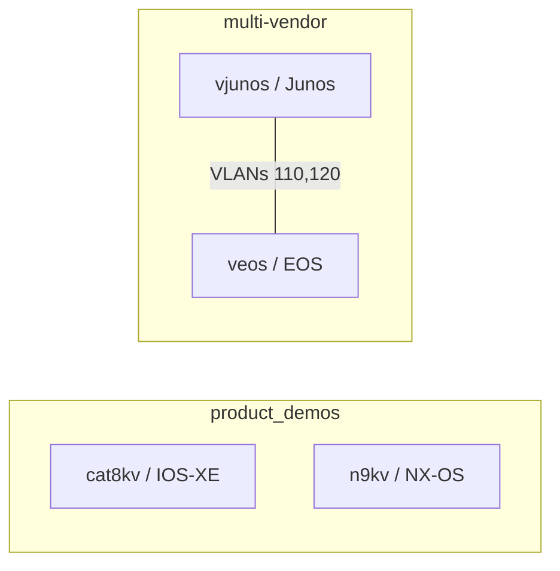

# Configure Devices

`network/configure_devices.yml` applies structured configuration across Cisco IOS-XE, Cisco NX-OS, Juniper Junos, and Arista EOS with vendor network resource modules and `state: merged`.

Run **NETWORK | Deploy Containerlab Stack** first, then **NETWORK | Containerlab | Configure Devices**. The job uses **Containerlab Device Access** and **ContainerLab Inventory**. `_hosts` defaults to `containerlab`; an extra variable can select a single platform or device.

## Independent labs

| Device | Data interfaces | Demo address | Loopback |
|---|---|---|---|
| `cat8kv` | No data links | Loopback only | 10.255.10.10/32 |
| `n9kv` | No data links | Vlan110 10.110.0.1/24 | 10.255.10.11/32 |
| `vjunos` | ge-0/0/1 trunk to EOS; ge-0/0/0 spare | irb.110 10.110.0.2/24 | 10.255.10.12/32 |
| `veos` | Ethernet1 trunk | Vlan110 10.110.0.3/24 | 10.255.10.13/32 |

Resource modules configure interface descriptions and state, IP addresses, switch VLANs and trunks, LLDP settings, and NTP. The original Cisco topology has no data links. Its configuration uses virtual interfaces and baselines, without assuming extra physical NICs or routing between the labs. Cisco banners and SNMP retain their existing baseline. NX-OS capabilities use `nxos_feature`; EOS enables global routing and LLDP in its bootstrap because the selected resource modules do not expose those switches.

Configuration data lives in `demo.network.configure_lab` defaults, separate from module invocation. Junos units and VLAN names and EOS trunk VLAN lists retain their vendor schemas. IOS-XE and NX-OS management configuration and existing upgrade interfaces remain in place. Cisco and EOS configuration is saved; Junos resource modules commit their changes.

Run configuration a second time during live acceptance and inspect for configuration drift. Some Cisco and EOS modules report changes for defaults even when before/after configuration matches. Then run **NETWORK | Containerlab | Validate Devices** and [**NETWORK | Report**](network-report.md). Lab redeployment resets configuration, so rerun Configure Devices afterward.
