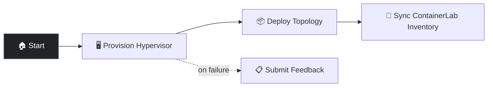

# Deploy Containerlab Stack

Provisions a self-contained multi-vendor lab on AWS: nested-virt EC2 hypervisor, containerlab topology (n9kv + cat8kv + vjunos + veos), and ContainerLab Inventory sync. This is the starting point for the network Configure, Report, Backup, and DISA STIG demos.

## Prerequisites

- **If using RHDP (demo.redhat.com):** Run **APD ǀ Multi-demo setup** (or **APD ǀ Single demo setup** and choose `network`). AWS and AAP credentials are pre-configured for you.
- **If using your own installation:** Run **APD ǀ Single demo setup** and choose `network`. Configure the **AWS** credential with your Access Key and Secret Key.

## Survey prompts

| Prompt | Variable | Type | Required |
|--------|----------|------|----------|
| AWS Region | `clab_aws_region` | multiplechoice | Yes |
| Instance Type | `clab_aws_instance_type` | multiplechoice | Yes |
| Owner | `clab_aws_owner_tag` | text | Yes |

Options: region `us-east-2` / `us-west-2`; instance type `c8i.4xlarge` (default) / `c8i.2xlarge`.

## Workflow

1. **Provision Hypervisor** — Creates VPC, subnet, security group, keypair, and launches a RHEL 9 EC2 instance with nested virtualization
2. **Deploy Topology** — Installs podman and containerlab, pulls network images, renders bootstrap credentials, starts all four devices, and configures persistent report hosting
3. **Sync ContainerLab Inventory** — Imports the hypervisor and sets device connection details for demo job templates
4. **Submit Feedback** — Opens only if hypervisor provisioning fails

Allow at least 15 minutes for vJunos boot plus image pulls. The Junos readiness timeout is 30 minutes. Validate this exact image on EC2 before treating the new topology as proven; the reported Azure test does not establish EC2 compatibility. The larger default instance supplies additional memory headroom, with actual usage still to be measured.

## Job templates

| Template | Playbook | Description |
|----------|----------|-------------|
| NETWORK ǀ Deploy Containerlab Stack | [`network/setup.yml`](../setup.yml) | Workflow that provisions hypervisor, deploys topology, and syncs inventory |
| NETWORK ǀ Containerlab ǀ Provision Hypervisor | [`network/provision_hypervisor.yml`](../provision_hypervisor.yml) | Creates AWS networking and the nested-virt EC2 hypervisor |
| NETWORK ǀ Containerlab ǀ Deploy Topology | [`network/deploy_containerlab.yml`](../deploy_containerlab.yml) | Installs containerlab and starts the four-device topology. Can also run standalone to redeploy the lab on an existing hypervisor; it discovers the running EC2 instance by tag. |

## Why it matters

- Replaces external Cisco DevNet sandbox dependencies with a fully self-contained lab
- Network resource modules demonstrate structured configuration across multiple network vendors
- Dynamic inventory + SSH Proxy credentials give AAP a clean path to the lab devices
- One workflow brings up everything the day-2 network demos need

## Presenter walkthrough

1. **Show the survey:** Region, instance size, and owner tag — explain how surveys keep self-service provisioning safe.
2. **Launch:** Start **NETWORK ǀ Deploy Containerlab Stack**. Call out the three success path nodes: hypervisor → topology → inventory sync.
3. **While it runs:** Explain nested virt, containerlab, and the four platforms (NX-OS SSH 2122, IOS-XE SSH 2123, Junos SSH 2124 / NETCONF 2830, EOS SSH 2125).
4. **Inventory sync:** After success, open **ContainerLab Inventory** and show the hypervisor/device hosts.
5. **Transition:** Run **NETWORK ǀ Containerlab ǀ Configure Devices**, then **NETWORK | Containerlab | Validate Devices**, then Report, Backup, or DISA STIG. Open the report URL from the Report job artifacts.

If a device misbehaves later, rerun **NETWORK ǀ Containerlab ǀ Deploy Topology** by itself with the AWS Region survey. It discovers the existing hypervisor automatically and redeploys the topology without reprovisioning AWS infrastructure.

## Related demos

| Demo | Description |
|------|-------------|
| 💥 [Destroy Containerlab Stack](./network-destroy-containerlab-stack.md) | Tear down the lab when finished |
| 🌐 [Configure Devices](./network-configuration.md) | Apply baseline banner, NTP, and SNMP |
| 🌐 [Report](./network-report.md) | Gather facts from the lab devices |
| 🌐 [Backup](./network-backup.md) | Back up running configs |
| 🌐 [DISA STIG](./network-disa-stig.md) | Audit IOS-XE against DISA STIG |

## Existing hypervisors and access

Deploy Topology refreshes the managed security group for the additional management ports and report HTTP port 8088. `clab_access_cidr` defaults to the existing public demo access behavior; restrict it to the execution nodes and presenter network when appropriate. Devices connect directly to port mappings; no SSH jump host is required.

Redeployment uses `--reconfigure`, resetting lab configuration to bootstrap. Run Configure Devices again afterward. Topology teardown removes the generated report; stack teardown removes its EC2 host and networking.

If a device times out before inventory sync, use **NETWORK | Containerlab | Troubleshoot** with the AWS region to collect hypervisor and container diagnostics. A TCP/SSH readiness check does not establish NETCONF authentication or a working forwarding plane; run Validate Devices after configuration.
